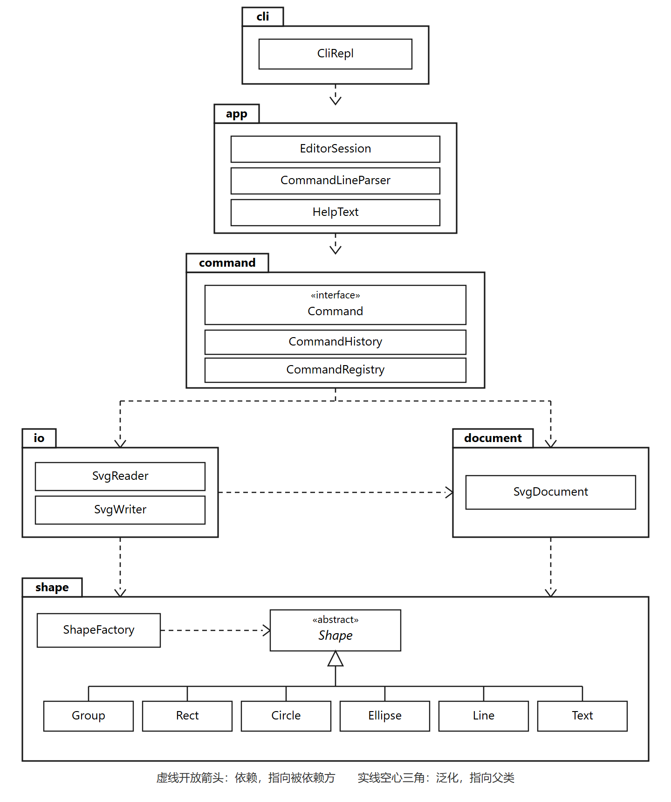

# SVG 编辑器（CLI）Phase 1

## 架构方案

### 模块划分

程序按职责分成六个模块。图形本身不知道命令和文件；命令不知道终端怎么读行。

下面这张包图表示模块依赖。类放在各自的包里，`Group` 和叶子类对 `Shape` 的泛化画在 `shape` 包内部。

图例：带折角的方框是包，其中的方框是类或接口。虚线开放箭头表示依赖，指向被依赖方。实线空心三角表示泛化，指向父类。`Shape` 是抽象类，名称用斜体。`Command` 为 `«interface»`。

| 模块 | 目录 | 职责 |
|---|---|---|
| shape | `src/shape/` | 图形层次。抽象类 `Shape` 规定移动、缩放、设属性、树摘要和写出 XML。叶子是 `Rect`、`Circle`、`Ellipse`、`Line`、`Text`。`Group` 是组合节点，对容器和叶子使用同一套操作。 |
| document | `src/document/` | 当前文档：画布尺寸、根子节点、大小写敏感的 id 索引、来源路径、元素计数。 |
| io | `src/io/` | 把文档读成对象、把对象写成可在浏览器打开的 SVG。缺 id 时按 `标签名+序号` 分配并警告。 |
| command | `src/command/` | 一条编辑命令是一个撤销单元。历史栈负责 undo/redo，以及文档类命令之后的锁定。 |
| app | `src/app/` | `EditorSession` 执行一行命令并返回要打印的文本，供 REPL 和测试共用。引号分词、`#` 注释和帮助文本也放在这里，避免会话反过来依赖终端。 |
| cli | `src/cli/` | `CliRepl`：提示符 `svg>`、读入一行、打印会话返回的文本。不碰具体图形类。 |

### 设计模式的选择

**Command** 每次成功的编辑都生成一个命令对象，上面有 `execute` 和 `undo`。`CommandHistory` 保存 undo 栈和 redo 栈。一条命令是一个撤销单元，所以 `group` 多个图形也只占一格。显示类命令不入栈。

文档类命令的锁定规则：

- `init` / `read` 替换当前文档，清空两栈并上锁。
- `save` 和带参数的 `canvas` 只上锁，不清栈。
- 锁着时 `undo` / `redo` 报 `error: undo not allowed after io command`。
- 下一次成功的编辑命令解锁。undo 之后如果有新编辑，redo 栈清空。
- 逆操作记在命令对象里：位移取反、属性旧值、删除前的父节点和下标、缩放前的几何快照。不克隆整份文档，避免 `1/factor` 的浮点误差。

**Composite** `Group` 与叶子都是 `Shape`。`move`、`scale`、`set`、`delete` 不区分调用方是容器还是叶子。组的移动和缩放递归到每个子孙，直接改几何数值，不写 `transform`。

**两处按名字分派，都标为待重构：**

1. `CommandRegistry`：命令名到命令类。REPL 不能到处 `switch` 命令名。
2. `ShapeFactory`：类型名或 SVG 标签名到图形类。读入和 `create` 都走这里。

其余行为走多态。例如 `SetCommand` 调用 `shape.set`，不按图形种类分支。本阶段 `create box` 仍报 `unknown shape type`，不实现插件接口。

### 依赖方向规则

允许的依赖只有向下：

- `shape` 不依赖任何业务模块。
- `document` 只依赖 `shape`。
- `io` 依赖 `document` 和 `shape`。
- `command` 依赖 `document`、`shape`、`io`。
- `app` 依赖 `command`（以及为了执行一行所需要的解析入口）。
- `cli` 只依赖 `app`。

这样规定是为了把变化隔开：换终端不必改图形；换文件格式不必改命令历史；加一种图形只经过工厂。`cli` 若直接 import 某个叶子图形，或 `shape` 若 import 命令，都是待处理项。

### 变化点假设

1. **新图形类型（例如后续的 `box`）。** 留了 `ShapeFactory` 这一处注册。本阶段不留 `ShapeProvider` 插件接口：题目把插件化划到下一阶段，现在做空接口没有调用方。
2. **新命令。** 留了 `CommandRegistry`。新命令实现 `Command` 后注册，不改 REPL 循环。
3. **图形界面或其它前端。** 留了 `EditorSession`。CLI 只负责读行和打印，测试可以直接调用会话。
4. **用 `transform` 或保留未知属性做无损往返。** 决定不留。`scale` 的语义是改几何属性；`set` 有白名单。再保留一套原始属性和变换矩阵，会和这两条规则冲突，也会把本阶段的读写扩大成通用 SVG 引擎。
5. **图形自己写出 SVG。** `Shape.toSvg` 在 `shape` 里，文件格式一变就要改图形类。本阶段不挪走：每种图形的标签和属性不同，写在类上才不会在 `io` 里按类型分支。以后格式要变，再把写出抽到 `io`。

## 评审记录

1. **意见：** 不保留 `transform` 和未知属性，读入真实 SVG 时变换会丢，这个假设容易被证伪。  
   **处置：** 拒绝。  
   **理由：** `scale` 规定的是改几何数值，`set` 有白名单。再存一套原始属性和变换矩阵，同一个图形会有两套数据。本阶段不把读写做成通用 SVG 引擎。

2. **意见：** `toSvg` 放在 `shape`，漏了一个变化点：换序列化格式时要改领域模型。  
   **处置：** 采纳。已补进变化点第 5 条。本阶段不把写出挪到 `io`。  
   **理由：** 挪走之后，`io` 必须按图形种类分支，和「按名字分派只留工厂」冲突。格式真的要变时再抽。

3. **意见：** 帮助文本放在 `app`、帮助命令放在 `command`，会造成 `command` 依赖 `app`。  
   **处置：** 采纳为已知违规，本阶段不改代码。  
   **理由：** 帮助文本是给终端看的，命令只负责返回它。要消掉这处依赖，得把文本挪进 `command` 或单独一个文本模块。自查里写明位置即可。

4. **意见：** `app` 和 `cli` 可以合成一个模块，六个模块对这个作业过细。  
   **处置：** 拒绝。  
   **理由：** `EditorSession` 要给测试和以后的界面用。`cli` 只读一行、打印结果。合在一起，换前端就要改会话。

5. **意见：** `CommandRegistry` 和 `ShapeFactory` 会变成加命令、加图形时的改动热点，现在就该做成插件。  
   **处置：** 拒绝。  
   **理由：** 名字分派已经集中在这两处，并标了待重构。本阶段没有第二种图形来源，空的 `ShapeProvider` 没有调用方。

## 过程记录

实现时改过三处最初的想法。

命令行解析一开始把所有 `#` 都当成注释，`#ffffff` 这种颜色会被吃掉。题目里的颜色和整行注释都要保留，所以只有行首注释，以及不是十六进制颜色的 `#`，才截断后面的内容。

架构图先用 PlantUML 画了包和类。类一多，线就会散开并溢出预览。后来改成一张 SVG 包图：依赖用虚线开放箭头，`shape` 包内部用空心三角表示泛化。

`box` 没有提前做成插件接口。工厂和命令注册表已经把类型名、命令名集中在两处，本阶段没有第二个实现，空的 `ShapeProvider` 没有调用方。

## 一致性自查

1. **实际目录与方案是否一致？** 一致。代码在 `src/shape`、`src/document`、`src/io`、`src/command`、`src/app`、`src/cli`。解析和帮助文本放在 `app`，方案的模块表里已经写了。
2. **不一致处是否已记入修订记录？** 目录没有不一致。评审后只补充了变化点第 5 条（`toSvg` 留在 `shape`），没有改模块划分。
3. **依赖方向有没有被违反？** 有一处。`src/command/HelpCommand.ts` 引用了 `src/app/HelpText.ts`，这是 `command` 依赖 `app`。方案规定的是 `app` 依赖 `command`。本阶段不改。其余抽样符合方案：`shape` 不引用 `command` 或 `io`，`document` 只引用 `shape`，`cli` 只引用 `app`。按名字分派仍只有 `CommandRegistry` 和 `ShapeFactory`。

## 质量保证手段

`npm test` 覆盖图形几何、文档索引、SVG 读写、文档命令的撤销锁、创建删除、移动缩放和属性，以及题目第 6 节的基础编辑会话和两节点流程图。`npm run typecheck` 做类型检查。失败的命令在改状态之前返回，测试里检查了重复 id、错误容器和读文件失败。
